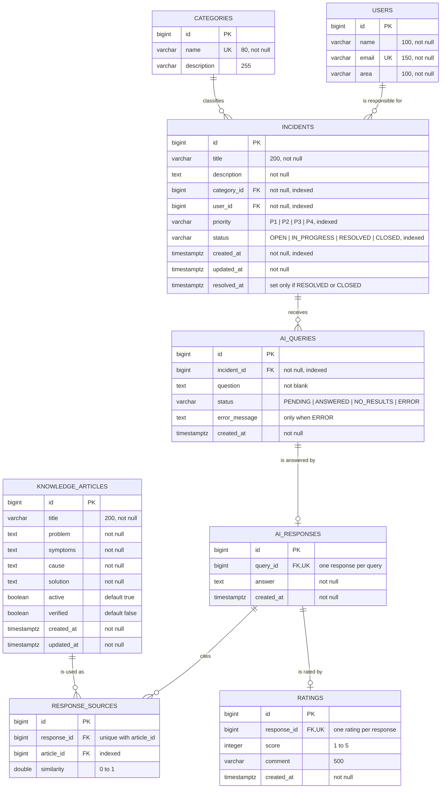

# Entity-relationship diagram

Source of truth: [`database/init/01_schema.sql`](../../database/init/01_schema.sql). JPA entities in `backend/src/main/java/com/campuslands/incidents/entity/` match it (Hibernate runs in `validate` mode).

## Relationships and delete rules

| Relationship | Cardinality | On delete | Reason |
|---|---|---|---|
| users → incidents | 1 : N | RESTRICT | Deleting a user would erase analytics history |
| categories → incidents | 1 : N | RESTRICT | Same: categories feed most indicators |
| incidents → ai_queries | 1 : N | CASCADE | AI history belongs to the incident |
| ai_queries → ai_responses | 1 : 0..1 | CASCADE | A query has at most one response (none while PENDING) |
| ai_responses → response_sources | 1 : N | CASCADE | Sources belong to the response |
| knowledge_articles → response_sources | 1 : N | RESTRICT | An article used as a source must stay in the history; deactivate it instead |
| ai_responses → ratings | 1 : 0..1 | CASCADE | One rating per response (RF08) |

## Integrity rules (CHECK constraints)

| Table | Rule |
|---|---|
| incidents | `priority` in P1–P4, `status` in the 4 values |
| incidents | `resolved_at >= created_at` |
| incidents | `resolved_at` is not null **if and only if** status is RESOLVED or CLOSED |
| knowledge_articles | Used as a RAG source only if `active AND verified` (partial index) |
| ai_queries | `status` in PENDING, ANSWERED, NO_RESULTS, ERROR; `question` not blank (test 7) |
| response_sources | `similarity` between 0 and 1; an article appears once per response |
| ratings | `score` between 1 and 5; one rating per response |
